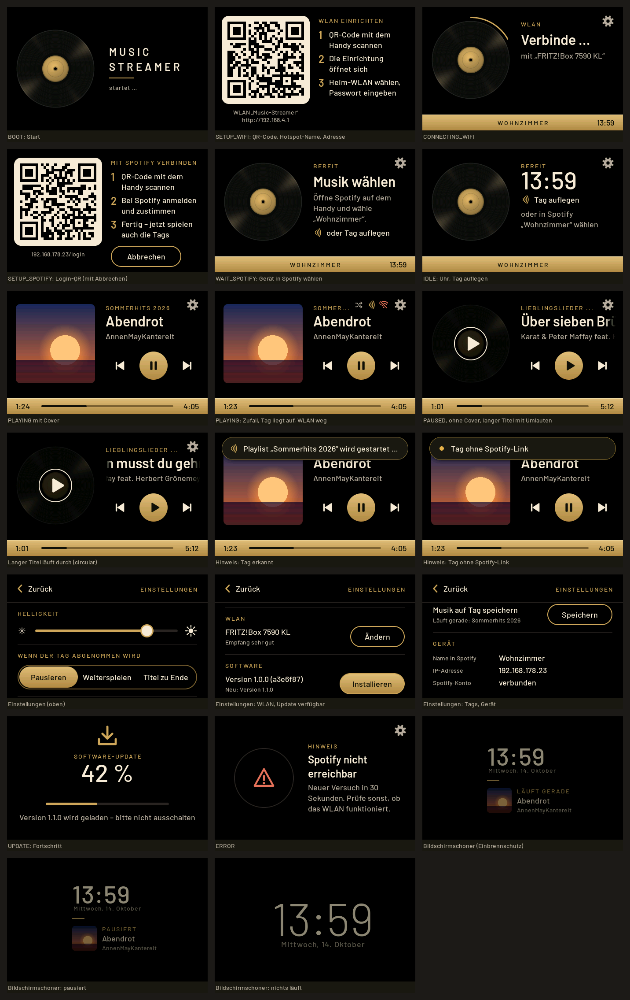

# Oberfläche (ui)

Stand: 13.10.2026. Komponente `firmware/components/ui`, PC-Simulator `firmware/components/ui/simulator`, Demo für das Gerät `firmware/components/ui/test_app`.



## Gestaltung

Richtung C: Querformat 456 × 280, schwarzer Grund, Messing `#C9A45C` als Akzent, Creme `#F2E8D5` für Text, Grau `#B5AB98` für Nebensachen, Messingleiste unten mit Fortschritt und Zeiten. Überschriften in gesperrten Messing-Versalien wie auf einem Verstärker.

- Schrift **Barlow** (SIL Open Font License 1.1, Lizenz in `assets/OFL-Barlow.txt`), mit `lv_font_conv` in 14 / 18 / 24 / 32 px, dazu 56 px nur Ziffern (Uhr, Prozent). Zeichensatz: ASCII, Latin-1 (ä ö ü ß …), Latin Extended-A, „“ ‚‘ – — … • € ™. Zusammen 155 kB Flash. Neu erzeugen: `tools/gen_fonts.sh`.
- Icons eigene A8-Masken (`tools/gen_assets.py`), statt LVGL-Symbolen: einheitlicher Strich, zur Laufzeit eingefärbt. Platzhalter ohne Cover: Schallplatte mit Messing-Etikett (180 × 180, 65 kB Flash).
- Kein Text unter 14 px. Trefferflächen: Transport 76 × 76, alle anderen ≥ 56 × 56 (meist mehr durch erweiterte Klickfläche).
- Wechsel zwischen Bildschirmen: kurze Blende über Schwarz (300 ms, ein halbtransparentes Rechteck, keine Zwischenpuffer).
- Einbrennschutz: nach 5 min ohne Berührung (Wiedergabe, Leerlauf, Warten) nur noch Titel bzw. Uhr klein und gedimmt, alle 20 s an anderer Stelle. Berührung weckt nur. Die Helligkeit des Panels ändert die UI nicht.

## Zustände (`ui_model_t.state`)

| Zustand | Bildschirm | Wichtige Felder |
|---|---|---|
| `UI_STATE_BOOT` | „Music Streamer – startet …“ | – |
| `UI_STATE_SETUP_WIFI` | QR-Code, drei Schritte, Hotspot-Name und Adresse als Text | `setup_qr`, `setup_ssid`, `setup_url`, `setup_cancelable` |
| `UI_STATE_SETUP_SPOTIFY` | QR-Code für den Spotify-Login (Ergänzung) | `setup_qr`, `setup_url` |
| `UI_STATE_CONNECTING_WIFI` | Schallplatte mit umlaufendem Bogen, „Verbinde … mit „SSID““ | `wifi_ssid` |
| `UI_STATE_WAIT_SPOTIFY` | „Öffne Spotify auf dem Handy und wähle „Name““, „oder Tag auflegen“ | `device_name` |
| `UI_STATE_IDLE` | große Uhr (sobald SNTP die Zeit gesetzt hat), „Tag auflegen“ | `device_name` |
| `UI_STATE_PLAYING` / `PAUSED` | Cover, Kontext, Titel, Interpret, ⏮ ⏯ ⏭, Fortschritt; Symbole für Zufall, Tag liegt auf, WLAN weg | `title` … `cover_*`, `shuffle`, `tag_present`, `wifi_ok` |
| `UI_STATE_UPDATE` | Prozent, Balken, Statuszeile | `update_progress` (> 100 = „Neustart …“), `update_text` |
| `UI_STATE_ERROR` | Warnsymbol, Titel, Text; Zahnrad bleibt erreichbar | `error_title`, `error_text` |

Überlagerungen: **Hinweis** oben (erscheint, wenn sich `toast_id` ändert; Info/NFC 4 s, Warnung/Fehler 7 s; Tippen schließt), **Einstellungen** (Zahnrad oben rechts oder langes Drücken auf der Wiedergabe; schließt nach 60 s ohne Berührung und bei Setup/Update).

Einstellungen (scrollbar): Helligkeit 5–100 %, „Wenn der Tag abgenommen wird“ (Pausieren / Weiterspielen / Titel zu Ende), Zufallswiedergabe, WLAN (Name, Empfang, „Ändern“), Software (Version, „Prüfen“ bzw. „Installieren“), Tags („Speichern“; solange `tag_write_supported` falsch ist, nur der Hinweis „Kommt mit einem der nächsten Updates“), Gerät (Name, IP, Spotify-Konto).

## Bedienung → Befehle

| Geste | Befehl (`arg`) |
|---|---|
| ⏯ oder Tippen aufs Cover | `UI_CMD_TOGGLE` (Anzeige wechselt sofort, App bestätigt) |
| ⏭ / Wischen nach links | `UI_CMD_NEXT` |
| ⏮ / Wischen nach rechts | `UI_CMD_PREV` |
| Zahnrad / langes Drücken (0,7 s) | `UI_CMD_OPEN_SETTINGS`; „Zurück“ → `UI_CMD_CLOSE_SETTINGS` |
| Helligkeitsregler | `UI_CMD_SET_BRIGHTNESS` (5…100), laufend beim Ziehen |
| Tag-Verhalten | `UI_CMD_SET_TAG_REMOVE_ACTION` (0 Pausieren, 1 Weiterspielen, 2 Titel zu Ende) |
| Zufall | `UI_CMD_SHUFFLE` (1 an, 0 aus) |
| WLAN „Ändern“ | `UI_CMD_OPEN_SETUP` (= `UI_CMD_OPEN_WIFI_SETUP`) |
| Software „Prüfen“ / „Installieren“ | `UI_CMD_CHECK_UPDATE` / `UI_CMD_START_UPDATE` |
| Tags „Speichern“ | `UI_CMD_WRITE_TAG` |
| „Abbrechen“ auf Setup | `UI_CMD_CANCEL` |

## Einbindung in die App

Abweichung von ARCHITECTURE §3: der Befehls-Callback hat ein zusätzliches `int32_t arg`; `UI_CMD_OPEN_SETUP` bleibt, sonst nur Ergänzungen.

```c
static void on_ui_cmd(ui_cmd_t cmd, int32_t arg, void *ctx)   /* LVGL-Task, LVGL gesperrt */
{
    app_event_t ev = {.type = APP_EV_UI, .ui_cmd = cmd, .arg = arg};
    xQueueSend(app_queue, &ev, 0);                              /* nur weiterreichen, nie blockieren */
}

lv_display_t *disp = display_init();
ui_set_command_handler(on_ui_cmd, NULL);
display_lock(0);
ui_init(disp);              /* einziger Aufruf mit LVGL-Sperre; legt den 30-ms-Timer für ui_tick() an */
display_unlock();
ui_model_publish(&model);   /* aus jeder Task, bei jeder Änderung; kopiert unter eigenem Mutex */
```

- Position: `position_ms` zum Zeitpunkt des Aufrufs; die UI zählt bei `PLAYING` selbst weiter. Alle paar Sekunden neu senden genügt.
- Cover: RGB565 in nativer Byte-Reihenfolge, am besten 180 × 180. Die UI kopiert die Pixel in `ui_model_publish()` (64 kB, landet per `malloc` im PSRAM), der Puffer der App darf danach freigegeben werden. Gleicher Puffer mit neuem Bild: `cover_id` hochzählen.
- Optimistische Anzeige (Play/Pause, Segment, Schalter) wird vom nächsten `ui_model_publish()` überschrieben – die App muss also den echten Zustand zurückmelden.
- `UI_CMD_SET_BRIGHTNESS` kommt beim Ziehen viele Male: sofort `display_set_brightness()`, in NVS erst bei `UI_CMD_CLOSE_SETTINGS` speichern.
- LVGL-Einstellungen aus `firmware/components/display/sdkconfig.lvgl` (u. a. `CONFIG_LV_USE_QRCODE=y`) müssen in der Firmware gesetzt sein.

## Speicher und Größe (ESP32-S3, `idf.py size-components` der Demo)

| | Flash | internes RAM statisch |
|---|---|---|
| `libui.a` | 255 kB (Code 19 kB, Schriften 155 kB, Schallplatte 65 kB, Icons 17 kB) | 2,9 kB |

Zur Laufzeit legt die UI 147 LVGL-Objekte an (alle Bildschirme einmal, danach nur ein-/ausgeblendet). Der Simulator zählt dafür 43 kB in 892 Blöcken ≤ 4 kB (64-Bit-Rechner; auf dem ESP32 geschätzt 25–30 kB). **Mit `CONFIG_LV_USE_CLIB_MALLOC` und `SPIRAM_MALLOC_ALWAYSINTERNAL=4096` landen diese kleinen Blöcke im internen RAM.** Empfehlung für den Integrator (Komponente `display`): `CONFIG_LV_USE_CUSTOM_MALLOC=y` und `lv_malloc_core/lv_realloc_core/lv_free_core` mit `heap_caps_malloc_prefer(n, 2, MALLOC_CAP_SPIRAM, MALLOC_CAP_INTERNAL)` usw. implementieren (dazu leere `lv_mem_init/deinit/add_pool/remove_pool/monitor_core/test_core` wie in LVGLs `lv_mem_core_clib.c`). Die Zeichenpuffer bleiben davon unberührt (DMA, von `esp_lvgl_port`).

## PC-Simulator

Voraussetzungen: CMake, C-Compiler, git. LVGL v9.3.0 kommt aus `-DLVGL_DIR=…`, sonst aus `managed_components` eines Firmware-Builds, sonst per `git clone`.

```bash
cmake -S firmware/components/ui/simulator -B build-sim && cmake --build build-sim -j
./build-sim/ui_sim docs/ui
```

Ergebnis: je Zustand ein PNG `docs/ui/NN_name.png` und `docs/ui/overview.png`. Danach 32 Prüfungen mit simulierten Berührungen (jede Taste mit Befehl und Argument, Wischen, senkrechtes Ziehen ohne Wirkung, langes Drücken, Regler, Segmente, Schalter, Scrollen der Einstellungen, Hinweis antippen, Zeitlimit der Einstellungen, Bildschirmschoner), ein Nebenläufigkeitstest (`ui_model_publish()` aus einem zweiten Thread während des Zeichnens) und ein Leck-Test des LVGL-Heaps (zusammen 34). Exit-Code 0 = alles bestanden. Die Zeit ist simuliert, nur die Uhr zeigt die echte Zeit.

## Demo auf dem Gerät

`firmware/components/ui/test_app`: `idf.py set-target esp32s3 && idf.py build && idf.py flash`. Rundgang durch alle Zustände (etwa 40 s), danach Wiedergabe mit drei Demo-Titeln; Tasten, Wischen und Einstellungen funktionieren, der Helligkeitsregler steuert das Panel. Freier interner Heap wird alle 10 s geloggt.

## Nicht getestet

- Nichts davon lief bisher auf dem Gerät: Lesbarkeit und Farben auf dem AMOLED (RGB565 ohne Dithering, Messingverläufe evtl. leicht stufig), Trefferflächen und Wischschwellen mit dem echten FT3168, Scrollen der Einstellungen per Finger, Bildrate bei Lauftext und Überblendung unter Audio-Last, tatsächlicher interner RAM-Bedarf (siehe oben).
- QR-Codes nur im Bild geprüft, nicht mit einem Handy gescannt (Ruhezone etwa 2 Module).
- Abgerundete Display-Ecken: Zahnrad und Zeiten liegen 6–20 px vom Rand; prüfen, ob etwas angeschnitten wird.
- Zusammenspiel mit der echten App (`main`): Reihenfolge der Ereignisse, Tag-Schreiben, OTA, SNTP/Zeitzone für die Uhr (ohne gültige Zeit zeigt Leerlauf „Musik wählen“ statt der Uhr).
